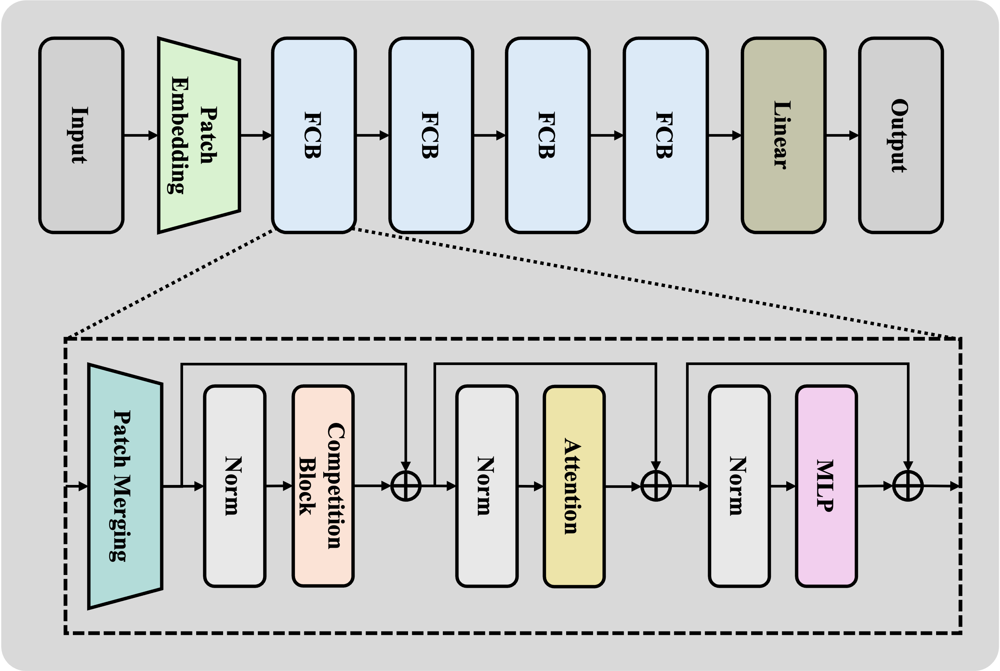
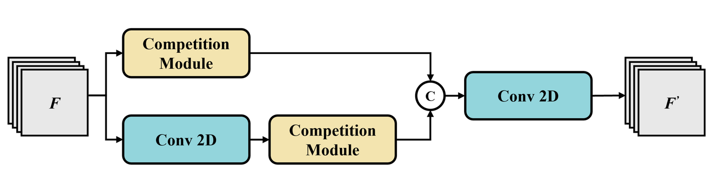

# LViT-CB

**A Lightweight Vision Transformer with Competitive Blocks for Finger Vein Recognition**

Official PyTorch implementation of our IS3C 2025 paper.

[Paper](https://ieeexplore.ieee.org/document/11130997) · [Installation](#installation) · [Dataset preparation](#dataset-preparation) · [Training](#training) · [Evaluation](#evaluation) · [Inference](#inference) · [Citation](#citation)

LViT-CB combines lightweight vision transformers with competitive blocks for finger-vein recognition. The model extracts image features and predicts finger identities. Its implementation is named `CLCNN` in the source code.

<p align="center">
  
</p>

<details>
<summary>Competitive block and competition module</summary>

<p align="center">
  
  
</p>

</details>

## Installation

Experiments require **an NVIDIA GPU with CUDA-enabled PyTorch**. The original experiments used an NVIDIA RTX 4080. Datasets and pretrained checkpoints are not included; prepare the data and train a model before evaluation or inference.

```bash
git clone https://github.com/Chi-An-Chen/LViT-CB.git
cd LViT-CB
conda env create -f environment.yaml
conda activate fingervein
python -m pip install torch==2.6.0 torchvision==0.21.0 --index-url https://download.pytorch.org/whl/cu124
python -m pip install -r requirements.txt
```

Use Linux or Windows with a compatible NVIDIA driver. See the [PyTorch installation instructions](https://pytorch.org/get-started/previous-versions/#v260) for details. Confirm CUDA is available:

```bash
python -c "import torch; print(torch.__version__, torch.version.cuda); print('CUDA available:', torch.cuda.is_available())"
```

Run the following commands from the repository root. All scripts accept `--help` and command-line overrides.

## Dataset preparation

Obtain FV-USM and/or PLUSVein-FV3 through their dataset providers and follow their usage terms. The preparation script indexes extracted-vein/ROI images; it does not download datasets or crop raw images.

### FV-USM

Arrange extracted-vein `.jpg` images by finger class. Use the same class folder names in both sessions:

```text
data/FV-USM/
├── 1st_session/extractedvein/<finger_class>/*.jpg
└── 2nd_session/extractedvein/<finger_class>/*.jpg
```

```bash
python 000_make_Dataset.py --datasets FVUSM --seed 42
```

This generates `datasets/annotations_fvusm.pkl` with a **4:1:1** training/validation/testing split for the expected six images per class per session. Both sessions contribute to each split.

### PLUSVein-FV3

Use the palmar ROI images with the original filename conventions:

```text
data/PLUSVein-FV3/PLUSVein-FV3-ROI_combined/ROI/
├── PLUS-FV3-LED/PALMAR/01/<subject_folder>/*.png
└── PLUS-FV3-Laser/PALMAR/01/<subject_folder>/*.png
```

The parser expects `<subject_folder>_<finger_index>` in image paths, with indices `02`, `03`, `04`, `07`, `08` and `09`.

```bash
python 000_make_Dataset.py --datasets PLUSVein --seed 42
```

This generates `datasets/annotations_plusvein.pkl` with separate LED and LASER subsets and a **3:1:1** split for the expected five images per finger.

Override source paths with `--FVUSM_root` or `--PLUSVein_root`. Use `--FVUSM_annotation_file` or `--PLUSVein_annotation_file` to change output paths. Running without `--datasets` prepares both datasets.

The seed defaults to **42**. Keep the generated annotation for use with its trained checkpoint: file enumeration can differ across machines, so the seed alone does not guarantee identical splits or label assignments.

## Training

```bash
# FV-USM
python 001_train.py --datasets FVUSM --device cuda:0

# PLUSVein: train both modalities
python 001_train.py --datasets PLUSVein --device cuda:0

# Train one modality
python 001_train.py --datasets PLUSVein --data_type LED --device cuda:0
```

Defaults: image size **112**, batch size **32**, **500** epochs, AdamW with learning rate **0.0002** and weight decay **0.0001**. Override options such as `--epochs`, `--batch_size`, `--workers` and `--seed` as needed. Use `--workers 0` if multiprocessing is unavailable; use a training batch size of at least 2.

Checkpoints are saved under:

```text
checkpoint_woComp/
├── FV-USM/None/
└── PLUSV-FV3/
    ├── LED/
    └── LASER/
```

Each run saves `Backbone_ckpt.pth.tar` and its `bestF1`, `bestAcc` and `bestLoss` variants. The historical directory name is retained; the model includes Competitive Blocks. Use `--root_model ./checkpoint/my_run` for a separate experiment to avoid overwriting previous checkpoints.

<details>
<summary>Using custom data or external annotation paths</summary>

Create a trusted local pickle with the same annotation format:

```python
annotations = {
    "Training_Set": [{"path": "class_a/train.jpg", "label": 0}, ...],
    "Validating_Set": [{"path": "class_a/val.jpg", "label": 0}, ...],
    "Testing_Set": [{"path": "class_a/test.jpg", "label": 0}, ...],
}
```

Use contiguous integer labels starting at zero, with the same class mapping across splits. For PLUSVein mode, nest this format under `LED` and/or `LASER`.

```bash
python 001_train.py --datasets FVUSM --annot_file /path/to/custom.pkl --data_root /path/to/images --classes 10 --pad_height_width 300 --root_model ./checkpoint/custom
```

Use matching settings for evaluation. `--data_root` prefixes relative image paths in the annotation; absolute paths are used unchanged. Keep your class-to-identity mapping separately. Only load annotations you generated or trust.

</details>

## Evaluation

After training, use the same annotation and model settings:

```bash
python 002_test.py --datasets FVUSM --device cuda:0
python 002_test.py --datasets PLUSVein --data_type LED --device cuda:0
```

The script combines validation and testing samples, compares the three saved best checkpoints, and reports classification accuracy, pair verification accuracy and EER in percent. Pair evaluation uses unique, non-self pairs and five seeded folds. These results are not an independent held-out test estimate; the current pairing/EER corrections may produce values different from the paper.

To evaluate one checkpoint:

```bash
python 002_test.py --datasets FVUSM --checkpoint ./checkpoint_woComp/FV-USM/None/Backbone_ckpt.bestAcc.pth.tar
```

For PLUSVein, also select `--data_type LED` or `LASER`. When loading your own trusted legacy checkpoint, add `--trusted_checkpoint`; this permits pickle loading and should not be used for untrusted files.

## Inference

Newly trained checkpoints contain the preprocessing settings needed for single-image inference:

```bash
python 003_infer.py --image /path/to/finger_roi.png --checkpoint ./checkpoint_woComp/FV-USM/None/Backbone_ckpt.bestAcc.pth.tar --device cuda:0 --output ./outputs/prediction.json
```

Output: a numeric class index, classification logits and a normalized **128-dimensional embedding**. Class indices correspond to the identities used for training. No same-person decision threshold is supplied.

For a legacy checkpoint without preprocessing metadata, provide its original training annotation and images:

```bash
python 003_infer.py --image /path/to/finger_roi.png --checkpoint /path/to/legacy.pth.tar --annot_file /path/to/original_annotations.pkl --trusted_checkpoint
```

Add `--data_type LED` or `LASER` for legacy PLUSVein checkpoints, and `--data_root` if needed. Checkpoints are intended for evaluation/inference and do not support exact training resume.

## Model analysis

Inspect the architecture and parameter/operation counts without a dataset or checkpoint:

```bash
python model_detail.py --datasets PLUSVein --device cuda:0
python model_detail.py --datasets FVUSM --device cuda:0
```

The output distinguishes registered parameters and profiler counts. MACs/FLOPs conventions vary between profiling tools. `model_detail.txt` is retained as historical output.

## License

Source code is licensed under [Apache-2.0](LICENSE). Dataset and third-party checkpoint terms apply separately.

## Citation

```bibtex
@INPROCEEDINGS{11130997,
  author={Chen, Chi-An and Chien, Tzu-Hung and Ke, Liang-Ying and Hsia, Chih-Hsien},
  booktitle={2025 Seventh International Symposium on Computer, Consumer and Control (IS3C)},
  title={A Lightweight Vision Transformer with Competitive Blocks for Finger Vein Recognition},
  year={2025},
  pages={1-4},
  doi={10.1109/IS3C65361.2025.11130997}
}
```
